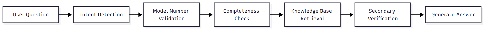
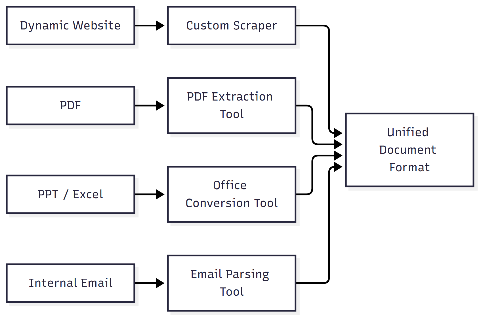
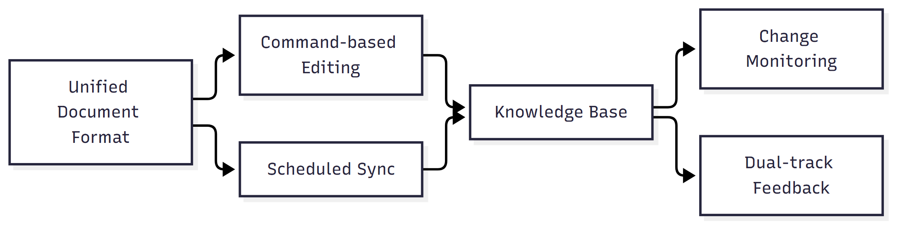
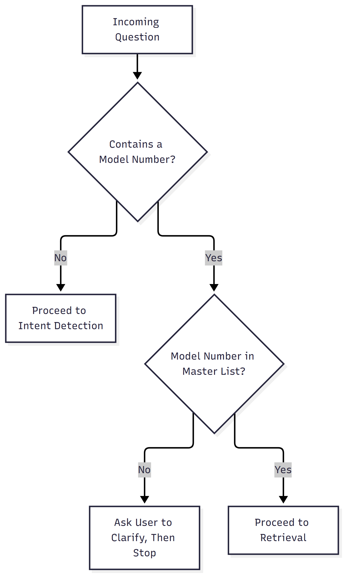
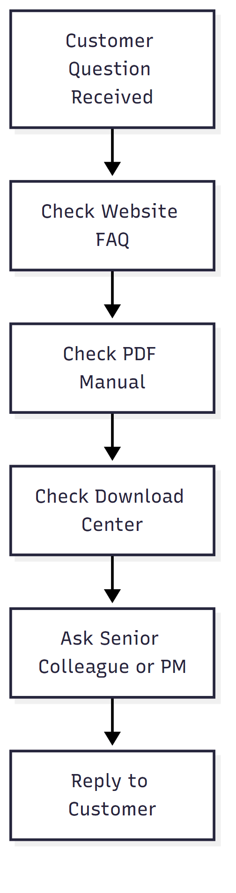
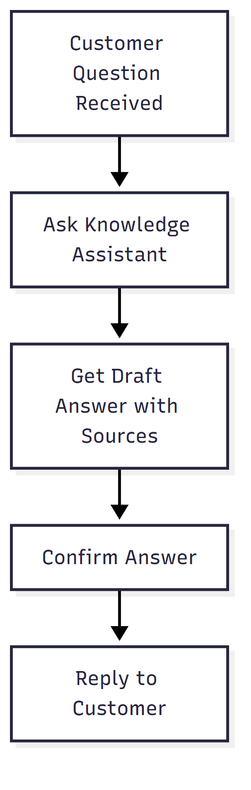

# Enterprise Internal AI Knowledge Assistant

An AI knowledge assistant built for a consumer electronics customer service team, so that support and technical staff can get a citable, correct answer to questions about specs, installation steps, and troubleshooting across a large number of product models within seconds — instead of digging through the public website, PDF manuals, and internal emails.

This project is an internal system at my current employer. Only the architecture and engineering methodology are shared here; no source code or internal system links are included.

**Tech stack:** Microsoft Copilot Studio (Generative Orchestration, custom Topics, SearchAndSummarizeContent generative node) · GPT-5 Chat (previously GPT-4.1) · Power Automate (downvote ticketing, knowledge-gap ticketing, scheduled weekly reports, file-change notifications) · SharePoint (knowledge base storage + semantic index) · Microsoft Teams (notifications) · Custom Node.js scraping/conversion tooling (cheerio, turndown, tesseract.js) · Python (python-docx, openpyxl, lxml) + PowerShell/pywin32 (PPT-to-image conversion) · Windows Task Scheduler (daily automated maintenance)

**Scope of personal contribution:**

| Area | Ownership |
|---|---|
| Problem definition and requirements | Independently scoped, based on firsthand frontline support experience |
| Conversation design and prompt engineering | Independently designed and written |
| Copilot Studio platform features | Configured and used native platform capabilities (Generative Orchestration, Topics, etc.); did not build the underlying engine |
| Data extraction/conversion tooling (Node.js, Python) | Independently developed, written with AI-assisted (vibe coding) development |
| Local maintenance dashboard | Independently developed |
| Test methodology design and execution | Independently designed the scoring rubric, built the question bank, executed and reviewed results |
| Post-launch maintenance and iteration | Independently maintained |

---

## The problem

To answer a single question, support staff previously had to piece together information from the public FAQ, PDF manuals, PPT decks, Excel spec sheets, and internal emails. Consumer electronics product lines include many similar model numbers — two series that share the same letter prefix can be completely different product lines, and a mix-up means handing a customer the wrong specs outright. The underlying knowledge was also scattered across formats that standard knowledge-base crawlers can't read: JavaScript-rendered website pages, PDF manuals, diagrams embedded in PPT decks, Excel comparison tables, and internal email threads.

## Architecture

**How a question gets answered:**

**How knowledge gets in:**

**How correctness is maintained:**

---

## The one rule that shapes everything else

Of all the rules in the system, exactly one is explicitly marked as "highest priority, overrides every rule below it": **the model-number matching rule** — different models are always treated as entirely different products, and data must never be reused across models just because they look similar, belong to the same series, or share similar features.

This isn't an arbitrary priority. A wrong model reference isn't "an incomplete answer" — it's the kind of error where the answer looks completely normal and the user has no way to even suspect it's wrong: fluent, logically coherent, and the only problem is that the underlying data actually belongs to a different model. It's nearly impossible to catch with manual spot checks, and the consequence is handing a customer the wrong spec outright. That's a fundamentally different risk tier from an incomplete or vague answer, so it has to be enforced structurally at the top of the rule stack — not left to the model "being careful this time."

Because this rule sits at the top of the priority stack, it overrides every other judgment in play at that moment, including whether a knowledge-base match was found at all. The diagram below illustrates the logic; it is not the literal system prompt:

This "overrides everything" priority explains nearly every design choice that otherwise looks independent:

- The four-layer protection described under **System Highlights** (master model list → never apply unconfirmed candidates → re-verify before output) exists purely to serve this one rule
- During **guided follow-up questions**, a missing model number is always the first thing asked for — not something asked about only after every other condition has been clarified
- During **query rewrite retries**, the model number string itself can never be rewritten by the model — only its prefix may be completed, while the rest of the query can be rephrased normally
- **List-type questions** (e.g. "which models support feature X") are further tightened: a model can only be listed if the retrieved data is itself an explicit model-to-feature mapping table — the system never infers "this model supports the feature" merely because the model number happens to appear in a document that mentions the feature. This, too, is an extension of the same rule.

In other words, remove this one rule and the system wouldn't crash or stop answering — it would just become "a system that answers faster, but occasionally gives Model A's specs under Model B's name," which is precisely the most costly failure mode in a customer service context. The entire point of this rule is to drive that risk as close to zero as possible.

---

## System highlights

- **Strict model-number matching, never similarity-based guessing** — a four-layer defense (master model list → ask for clarification instead of guessing when not found → re-check every citation before output), preventing data from visually or categorically similar models from being cross-applied. Details: [`conversation-design/`](conversation-design/)
- **Custom data-extraction pipeline** — dedicated conversion logic for JS-rendered pages, PDFs, PPT diagrams, and Excel cross-tables, so formats that standard knowledge-base crawlers can't read still make it into the knowledge base. Details: [`data-pipeline/`](data-pipeline/)
- **Command-based editing with concurrency-safe scheduled sync** — diff preview, automatic backups, file locking, real-time change notifications, and one-click rollback. Details: [`change-management/`](change-management/)
- **Dual-track feedback growth loop** — "no data found" and "wrong answer" are tracked separately, each reported on its own cycle, because they point to entirely different root causes. Details: [`feedback-loop/`](feedback-loop/)

---

## Scale and impact

Consolidated FAQ, product manuals, operating instructions, and image-based knowledge across multiple product lines into a single centralized AI query system.

**Before:**

**After:**

Previously, staff had to repeatedly search and cross-reference the website, PDF manuals, spec sheets, and internal documents — a process that was both time-consuming and prone to cross-document mix-ups that pulled in the wrong model's data. After launch, staff ask a natural-language question directly, get a draft answer with its source, confirm it, and reply — skipping the manual search process entirely.

**Impact areas:**

- **Lower citation risk** — model-number validation and source cross-checking prevent data from being misapplied across models
- **Less duplicated searching** — knowledge is centralized, so the same question doesn't need to be looked up separately across multiple systems
- **Continuously updated knowledge** — a maintainable pipeline across multiple document formats, not a static database that goes stale after launch
- **Continuous quality improvement** — testing, user feedback, and knowledge-gap tracking form a closed loop; launch is a starting point, not an endpoint
- **Built on existing enterprise infrastructure** — runs on the organization's existing Microsoft 365 platform (Copilot Studio, Power Automate, SharePoint), with no need to introduce a new system

Query efficiency, answer accuracy, and knowledge coverage are tracked internally as ongoing indicators and adjusted based on real usage.

## Methodology and evaluation

- **Anti-hallucination design:** precise model-number matching; the system proactively asks for clarification rather than guessing when data is insufficient; answers are never inferred from similarity; numerical data must be quoted verbatim, never paraphrased.
- **Knowledge governance:** a single source of truth (SharePoint), real-time change notifications, a closed-loop knowledge-gap feedback mechanism, and automatic disclaimers on internally-restricted information.
- **Testing and iteration:** a test question bank covering spec lookups, configuration, troubleshooting, and cross-model comparisons, iterated repeatedly before launch to refine prompts and retrieval rules; after launch, tracking shifts to real support queries, with results graded and combined with user reports to identify what needs improvement. Full scoring rubric, test cases, and specific fix records: [`evaluation/`](evaluation/)

## Limitations and future direction

**Current limitations:**

- Classifying and tagging knowledge sources still requires manual maintenance; this isn't fully automated yet.
- Cross-model comparison questions rely on a separately maintained comparison table — retrieval alone can't reliably assemble a complete set of differences in one pass.

**Planned:**

- **Expand cross-language support** to cover overseas teams' use cases, beyond just detecting Chinese vs. English.
- **Integrate with internal ERP/repair-tracking system APIs**, so that data outside the knowledge base — repair status, parts availability — can also be queried, instead of only answering from what's already been curated into the knowledge base.
- **Evolve from "query" to "action":** the agent currently only answers questions. The plan is to let users issue instructions through the conversation, with the chatbot calling backend systems to execute them on their behalf. This is a step-change in the agent's role — from a read-only knowledge assistant to one with real operational capability — which also means the "scope boundaries" and "anti-hallucination" rules described in [`conversation-design/`](conversation-design/) would need a new layer of design: a wrong answer to a query is bad information, but a wrong instruction actually changes system data — the margin for error is completely different.

## Technical scope

| Layer | Description |
|---|---|
| AI agent layer | Conversational agent built in Microsoft Copilot Studio (Generative Orchestration) — custom Topics, the SearchAndSummarizeContent generative node, custom node instructions, and conversation flow rules for intent detection and model-number validation gating; model iterated from GPT-4.1 to GPT-5 Chat |
| Knowledge base | SharePoint Online / OneDrive for Business (document libraries + lists) as the centralized knowledge source and semantic index, with classification and permissions split by internal/external disclosure level; zh-TW as the primary language, en-US/en-GB as secondary |
| Automation | Power Automate cloud flows covering wrong-answer ticketing, knowledge-gap tracking, two scheduled weekly reports, and SharePoint-triggered file-change notifications, pushed via Teams |
| Custom extraction tooling | A scraping and format-conversion toolkit in Node.js (≥20, ES Modules) — cheerio parsing with throttled requests, turndown for Markdown conversion, tesseract.js OCR, and multimodal LLM-generated image captions with caching — producing Word files for the knowledge base; also includes a local maintenance dashboard (native Node REST API + plain web frontend), tested with `node --test` |
| Office document conversion | Python (python-docx / openpyxl / lxml) for parsing Word/Excel/OOXML structure; PowerPoint decks are separately converted to images via PowerShell + pywin32 COM automation, then processed through the same visual-extraction pipeline and batch-cleaned by AI Builder |
| Sync and scheduling | File-fingerprint diffing (sync v2) — conflicts are never auto-resolved by overwriting; Windows Task Scheduler + `.cmd` batch scripts run automated maintenance twice daily (morning and afternoon), with file locking to prevent duplicate runs |

## Further reading

| File | Contents |
|---|---|
| [`conversation-design/`](conversation-design/) | Role and scope boundaries, intent detection, the four-layer model-matching defense, guided follow-up questions, anti-hallucination rules, query rewrite retries, tiered source labeling, language consistency, and three failure modes |
| [`data-pipeline/`](data-pipeline/) | Dynamic web scraper technology choices, visual extraction + caching for image-based content, rules for flattening complex tables, PPT/Excel office-format conversion, a PII-masking checkpoint, automated audit reports, and tests for the pipeline tooling itself |
| [`change-management/`](change-management/) | A custom local maintenance dashboard, command-based editing (diff preview + backups), file-fingerprint sync, real-time change monitoring and rollback, concurrency-safe scheduling with file locking, and incremental vs. full sync modes |
| [`feedback-loop/`](feedback-loop/) | Separate tracking tracks for knowledge gaps vs. wrong-answer reports, and low-friction reporting design |
| [`evaluation/`](evaluation/) | The test process, five real issues from discovery to fix, a three-tier scoring rubric, iteration and tracking results, and the AI-assisted review process |
| [`examples/`](examples/) | A system-exported language-detection Topic (a Copilot Studio low-code syntax example, containing no business logic or company information) |
