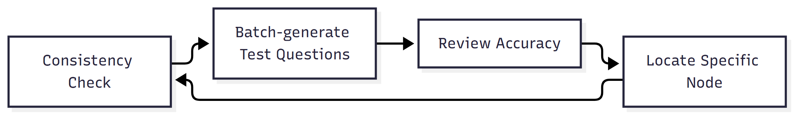

# Testing and Evaluation

A knowledge-base agent's "correctness" can't be verified with unit-test assertions the way traditional software can, but it also isn't something you can just eyeball with a few sample questions and call good enough. The whole process is designed as a loop: generate a large volume of questions → batch automated testing → manual review → pinpoint the exact failing node → fix → retest — run once before launch and again after, at different scales, with every fix explicitly tied to "what changed, and what difference it made" rather than just watching a single aggregate score move.

## Test process

1. **Consistency check**: the same question is tested multiple times to check whether the bot answers consistently. Any inconsistency on the same question signals ambiguity in a topic's or instruction's decision logic, and gets fixed immediately — rather than waiting for it to surface in a real support interaction.
2. **Batch-generate test questions**: before launch, Copilot Studio's built-in Agent Evaluation test-set feature (which auto-generates questions from existing Topics) is used to build a question bank covering features, troubleshooting, firmware, comparison questions, and trap questions (deliberately asking about a model that doesn't exist), and the bot is run through the full set at once.
3. **Review accuracy from conversation logs**: both batch test results and real support-query logs are reviewed question by question and classified into the three-tier rubric below.
4. **Pinpoint the exact node, then fix**: when an answer is wrong or inconsistent, the fix isn't a vague "tweak the prompt somewhere" — the root cause is first traced to the specific rule within a specific topic or instruction set, or the specific document, and the fix is scoped as narrowly as possible to that one node.
5. **Back to step 1 and retest**: a fix isn't considered done just because it was made — the same batch of questions (including the ones that originally failed) is retested to confirm the fix actually worked and didn't break anything that previously passed.

## Concrete cases: 5 real issues, from discovery to fix

Rather than just describing the "ablation-style validation" methodology in the abstract, here are the actual cases that occurred — each row is "the real error before the fix → root cause → how it was fixed → the result after retesting." Model numbers have been replaced with fictional placeholders to avoid exposing the real product line, but the confusion mechanism caused by the letter prefix/suffix and the scenario itself are both real:

| Issue found | Root cause | Fix | Result after fix |
|---|---|---|---|
| Asked how long Model A520WT can record for, got back data for "520" instead, with a link to a different model attached | Similar model names (differing by one letter prefix) got cross-matched during retrieval | Added a model-identification rule to the instructions; every piece of knowledge is now tagged with its applicable model | No longer borrows data from other models; proactively states when data is insufficient, and attaches the A520WT-specific manual |
| Asked about Model D760, got back a feature that actually belongs to Model A915XR | When a slide deck was converted to text, a model mentioned only for comparison purposes got mistakenly stored in the knowledge base as the main subject | Fixed the source document and removed the misattributed model number and keywords | Answers now cite only documents for the correct model |
| A comparison question (Model BX10 vs. BX20) got an incomplete answer | The differences between the two models were spread across separate documents, so a single retrieval pass couldn't gather them all | Built a dedicated "model difference comparison table" | All six differences are now listed completely, with nothing missing |
| A question asked in English got answered in Chinese | The agent was initially only configured for Traditional Chinese | Added English language support, with instructions to reply in the language the question was asked in | English questions now get fully English answers |
| When no answer could be found, no one knew what was missing from the knowledge base | No reporting or tracking mechanism existed; gaps were only noticed anecdotally and easily forgotten | Automatic knowledge-gap logging, a one-click wrong-answer report, and an automatically compiled weekly report on a fixed schedule | Gaps are now tracked consistently every week and queued for follow-up |

These five cases span four distinct layers of the system — retrieval logic (issues 1 and 2), knowledge coverage (issue 3), language configuration (issue 4), and operational tooling (issue 5) — and the fixes correspond to entirely different kinds of actions (rule change / document fix / data addition / configuration change / process addition). No single fix pattern covers everything.

## Scoring rubric

A test question bank was built covering spec lookups, configuration, troubleshooting, purchase recommendations, and cross-model comparisons — the full range of real support queries — with every answer either manually reviewed or AI-scored into one of three tiers:

| Tier | Definition | Score threshold |
|---|---|---|
| Correct | Content is accurate and complete, and the cited model exactly matches what the user asked about | ≥ 0.9 |
| Partially correct | Directionally correct but missing detail, or explicitly flagged as using a similar model as reference | 0.8 – 0.85 |
| Incorrect | Wrong answer, or data borrowed from another model without disclosing it | < 0.8 |

Writing "does the cited model match" directly into the scoring rubric — rather than just judging "does the answer sound right" — reflects the fact that mixing up models is the single most common and hardest-to-catch error type in this kind of system through manual spot checks alone; the rubric has to be designed to actively surface this error, not just check whether the language is fluent.

**On where "partially correct" sits:** honestly stating "no data found in the knowledge base," or explicitly flagging a similar model as reference material that isn't a full match, both fall under partially correct — not an untracked separate category, and not incorrect. These answers contain no false information, just incompleteness, which is a fundamentally different tier of problem from "fabricating an answer" or "using another model's data without disclosing it." The rubric deliberately treats these two situations differently.

## Iteration and tracking results

Two **independent measurements** are presented here, from different stages and different question banks — they are not a before/after comparison on the same set of questions, and shouldn't be read that way:

- **Version iteration testing (pre-launch):** the same question bank was tested repeatedly while iterating on prompts and retrieval rules, retesting after every fix to verify "did this change actually improve performance on the same set of questions" — with a consistent upward trend in scores over successive rounds.
- **Post-launch tracking:** evaluation shifted to real support queries, scored by AI with human confirmation, classified into correct / partially correct / incorrect. The source, volume, and difficulty distribution of these questions differ from the pre-launch test bank, so the two sets of numbers aren't directly comparable.

**Root-cause analysis of the "not fully correct" cases:** tracing every partially-correct case back to its root cause showed that **all of them came down to "this data simply isn't in the knowledge base yet" — not one was the AI fabricating or guessing an answer.** For example, model data only existed up to T640WD, with no T640W version available — the agent honestly stated this and referenced the similar model, rather than presenting the T640WD data as the standard answer. This meant the issue was entirely a matter of "content coverage," not "the agent making things up," so the fix could be clearly scoped to adding documentation, without needing to guess whether the anti-hallucination design had somehow failed.

## Independent review of conversation design

The conversation design logic was also separately reviewed by an AI tool, across two rounds. After receiving each round's findings, every issue was first manually reproduced against the actual conversation flow logic to confirm it was real and understand the root cause before deciding whether to adopt the suggestion — findings weren't accepted at face value just because a review tool flagged them. A review tool is good at surfacing blind spots, but deciding whether and how to act on a finding still requires independently verifying it.

## Audit mechanism for the automation pipeline

On the data extraction and conversion side, every automated run produces an audit report — how many records were updated this run, what needs manual follow-up, and which images need further analysis — so that "what the automation did" can always be checked, rather than running silently with no way to confirm the result is correct.
